CallFlow backend

1. [1. Backend structure](#structure)
2. [Startup and config](#startup)
3. [URL routing](#routes)
4. [Layers and files](#layers)
5. [Jobs, logging, timeouts](#runtime)
6. [2A. Architecture](#diag-a)
7. [2B. Module dependencies](#diag-b)
8. [2C. API execution flows](#diag-c)
9. [2D. Function call graph](#diag-d)
10. [2E. Data flow](#diag-e)
11. [2F. External integrations](#diag-f)
12. [2G. Runtime sequences](#diag-g)
13. [3. Dependency and risk analysis](#analysis)
14. [Defects found](#bugs)
15. [Performance](#perf)
16. [Races and shared state](#races)
17. [Duplication and coupling](#dupes)
18. [Unused and unreachable](#unused)
19. [4. Dependency matrix](#matrix)
20. [5. How it fits together](#explain)

Code-verified architecture map

# CallFlow Backend Map

How the Django backend behind the CallFlow portal, STCC and NCI starts, routes requests, runs its analysis DAG and talks to Trino, Smartcare, NPP, Splunk, Viavi and Remedy. Every relationship below was read from the source, not inferred from file names.

Snapshot **H:\\Shaimaa_vodafone\\callflow_backend_personal** Taken **2026-10-14**, includes today's NPP and Splunk fixes **108** Python modules, **18,269** lines Frontend excluded

VERIFIED read directly in the code POTENTIAL real code path; impact needs runtime measurement ASSUMPTION depends on deployment outside the repo DEFECT code does something other than what it intends

## 1. Backend structure

One Django 4.2 project (`callflow_portal`) with two installed apps that serve traffic: `callflow` (the portal API, all real code under `callflow/core`) and `NCI` (a site-level API for an external caller). Neither app defines a model; the database is used only by Django's own admin, auth and session apps. All business data comes from six external systems at request time.

### Entry points, startup and configuration

| File | What it does | Notes |
| --- | --- | --- |
| `callflow_gunicorn_start` | Production launcher: `gunicorn callflow_portal.wsgi:application`, 3 workers, Unix socket, `--timeout 100080`, log level `error`. | VERIFIED No `--worker-class` or `--threads`, so workers are Gunicorn's default sync workers: one request at a time per worker. |
| `manage.py` | Sets `DJANGO_SETTINGS_MODULE=callflow_portal.settings`, runs management commands. | Development / admin entry. |
| `callflow_portal/wsgi.py` | Builds the WSGI app, then silences urllib3 TLS warnings and dateutil timezone warnings process-wide. | Warnings are silenced because Trino and Splunk calls use `verify=False`. |
| `callflow_portal/asgi.py` | Standard ASGI app. | ASSUMPTION Not used by the Gunicorn script. |
| `callflow_portal/settings.py` | `load_dotenv(BASE_DIR/.env)` for Smartcare, Splunk and Viavi credentials; `from general_apis.constants import *` for the MSSQL server, user and driver; apps, CORS, middleware, two databases, Redis cache, data-file paths, `OUTPUT_DIR = BASE_DIR/callflow_output`. | VERIFIED `DEBUG = True` (line 51). No `REST_FRAMEWORK` block, so DRF defaults apply (AllowAny). No `LOGGING` block. |
| `.env` | Keys: `smartcareDB_USER/PASSWORD`, `splunk_USER/PASSWORD`, `viavi_ip/port/service_name/user/password`, plus `mediation_*` and `rpa_*` keys that no Python file reads from the environment (the prototype hardcodes its own mediation values). | `NCI_API_SECRET_TOKEN` is read by settings but not defined in `.env`. |
| `general_apis/constants.py` | `MACHINE = "Remote"`, SQL driver, MSSQL host `10.30.30.177` and its credentials, database names. | Imported at settings load, so it is part of startup. |
| `callflow/core/constants/configs.py` | Smartcare JDBC jar path, driver class and URL. | Read when the first Smartcare connection starts the JVM. |
| `requirements.txt` | Contains only `openpyxl`. | VERIFIED The real dependency set (Django, DRF, corsheaders, python-dotenv, django-redis, pandas, requests, trino, jaydebeapi, JPype1, cx_Oracle, pyodbc, mssql-django, pytz) is not pinned anywhere in the repo. |

**Import-time side effects.** `utils/file_cache.py` creates `/home/AutomationProjects/CallFlowTool/backend/callflow_portal/cache_store` when imported (line 20), and `utils/trino_client.py` prints on import. The JVM for Smartcare is started lazily by the first `smartcareConnection()` call, not at startup.

### URL routing and API endpoints

Routing chain: `callflow_portal/urls.py` → `include("callflow.urls")` and `include("NCI.urls")` → `callflow/urls.py` → `include("callflow.core.urls")` and `include("callflow.prototype.urls")`. Every live route is listed below.

| Method and path | View (file:line) | Mode | Does |
| --- | --- | --- | --- |
| `POST /callflow/api/analysis` | `AnalysisOrchestratorAPIView` (`core/views/orchestrated_analysis.py:61`) | Job, 202 | Full portal analysis over the 11-task DAG. |
| `GET /callflow/api/analysis/{job_id}` | same class, `JobBackedAPIView.get` (`job_base.py:86`) | Poll | Returns the job dict from Redis (status, systems, summary, dashboard, details, rca, result). |
| `GET /callflow/api/analysis/{request_id}/rca-status` | `RCAStatusAPIView` (`:674`) | Sync | Reads `rca/{id}/manifest.json`, returns readiness. |
| `GET /callflow/api/analysis/{request_id}/rca-files` | `RCAFilesAPIView` (`:684`) | Sync | Lists READY files bucketed as kpi / filter / threshold. |
| `GET /callflow/api/analysis/{request_id}/file/{filename}` | `RCAFileDownloadAPIView` (`:694`) | Sync | Path-safe file download for the RCA tool. |
| `POST /callflow/api/stcc/analysis` + `GET …/{job_id}` | `STCCAnalysisAPIView` (`core/views/stcc_analysis.py:140`) | Job, 202 | Same DAG restricted to Trino, NPP, Viavi, Remedy. |
| `POST /callflow/api/smartcare/site-kpis` | `SmartcareSiteKpiAPIView` (`core/views/smartcare_site_kpi.py:12`) | Sync | Smartcare S1-MME and S6a site KPIs over three 12-hour windows. |
| `POST /callflow/api/npp/kpis` | `NppKpiAPIView` (`core/views/test_npp_kpi.py:24`) | Sync | Raw NPP rows for cells or sites. |
| `POST /callflow/api/viavi/kpis/` | `ViaviKpiAPIView` (`core/views/test_viavi_kpi.py:25`) | Sync | Raw Viavi rows for sites. |
| `POST /callflow/api/remedy/kpis/` | `RemedyKpiAPIView` (`core/views/test_remedy_ticket.py:42`) | Sync | Remedy tickets for sites (7-day lookback). |
| `POST /callflow/NCI/analysis/` + `GET …/{job_id}/` | `NCIAnalysisAPIView` (`NCI/views.py:57`) | Sync by default; job + callback when `callback_url` is sent | Per-site NPP, Viavi, Remedy over current, minus 1 day and minus 1 week (12-hour windows). |
| `POST /callflow/NCI/rca/` + `GET …/{job_id}/` | `NCIRcaSitesAPIView` (`NCI/views.py:184`) | Same as above | RCA-tool scoring of sites, server-side. |
| `/admin/` | Django admin | Sync | No app models are registered. |

VERIFIED `callflow/prototype/urls.py` has an empty `urlpatterns`, so the prototype views and `apis.py` are imported at startup but no URL reaches them. About 30 older routes in `core/urls.py` are commented out.

### Layers and important files

#### Views and handlers

`views/base.py`: `BaseCallFlowAPIView` with `parse_request_time_range`, `build_analysis_time_windows` (current = start − 2 h … end; previous 1 and 3 days; query span covering both), `get_log_file`, `log_request`.

`views/job_base.py`: `JobBackedAPIView` with `post` → `build_log_context` → `create_job` → daemon thread `_run_safely` → `run_job`; `get` polls.

`views/orchestrated_analysis.py` (705 lines) wraps every data source to stream dashboard values, details and RCA files into the job.

#### Orchestration

`orchestration/scheduler.py`: generic DAG runner `run_plan` with a thread pool, per-task deadlines, failure isolation (dependents become SKIPPED).

`orchestration/pipeline.py`: the CallFlow DAG (`build_callflow_plan`), `default_sources` binding tasks to services, status roll-ups.

Helpers: `cell_resolution`, `customer_counts`, `smartcare_index`, `dashboard_shaping`, `summary_readiness`, `rca_files`, `task_logging`.

#### Analyzers

`orchestration/analyzers/`: `NppAnalyzer`, `ViaviAnalyzer`, `RemedyAnalyzer`, `SplunkAnalyzer` each return the common contract from `base.build_result`. `severity.py` keeps High/Increase/Medium only. `rca_threshold.py` is the threshold rule engine shared with `KPIAnalyzer`.

#### Business services

`services/kpi_analyzer.py`: `KPIAnalyzer.analyze_npp`, `analyze_viavi`, `analyze_core_node` (Splunk), thresholds from `kpi_thresholds.KPIThresholds` (Python dicts).

Retrieval: `trino_service`, `smartcare_service` + `smartcare_query_runner`, `npp_service`, `splunk_service`, `viavi_service`, `remedy_service`, `smartcare_site_kpi_service`.

#### Data access

`utils/trino_client.py` (Trino DB-API, cached connection), `utils/connections.py` (Smartcare JDBC via JPype, Viavi cx_Oracle), `utils/classes.Connection` (pyodbc to MSSQL), `connectors/connection_pool.py` (generic pool used by NCI only). No ORM models, serializers or repositories exist.

#### Shared utilities

`utils/data_utils.py` (`process_sitename`, `convert_java_types`, `extract_suffix`), `utils/file_cache.py` (pickle cache + key builders), `utils/logging_utils.py` (`build_request_logger`, `get_request_identity`), `utils/site_mapping.py`, `utils/mapping_cell_name.py`, `utils/java_sanitize.py`, `services/_parallel.run_in_order`.

#### NCI app

`NCI/service/analysis_runner.py` (`run_nci_analysis`, fetchers with file cache and pools, `build_site_summary`), `NCI/service/rca_site_runner.py` (`run_rca_site_analysis`), `NCI/connectors/viavi_pool.py`, `remedy_pool.py`, `NCI/utils/helpers.py`, `NCI/utils/authentication.require_api_token` (not applied).

#### Constants

`constants/queries.py` (Smartcare HiveQL: 6 Data and 6 Voice node queries), `constants/endpoints.py` (`SPLUNK_ENDPOINTS`, `SPLUNK_SUFFIX_TO_SMARTCARE_NODE`, `NODE_COLUMNS_FROM_SMARTCARE`, `VIAVIE_KPIS_MAPPING`), `smartcare_sites_queries.py`, `general_constants.py`.

### Background jobs, logging, retries and timeouts

**Asynchronous execution.** There is no Celery, cron registration, Django signal or scheduler inside the app. Long work runs in a `threading.Thread(daemon=True)` started inside the Gunicorn worker that received the POST (`job_base.py:70`, `NCI/views.py:117` and `:243`). Job state lives in Redis through Django's cache (`jobs/job_manager.py`, TTL 30 min refreshed on every update), so any worker can answer a poll. The only scheduled job is the shell script `scripts/clean_complain_reports.sh`; ASSUMPTION it is run by an external cron that is not in the repo.

**Logging.** Three layers: a per-request `LoggerAdapter` writing to `callflow_output/logs/{prefix}.txt` (`logging_utils.build_request_logger`); per-request, per-system files under `callflow_output/rca/{request_id}/logs/{system}.log` (`task_logging.get_system_logger`); and module loggers. ASSUMPTION With no `LOGGING` setting and Gunicorn at `--log-level error`, module-level `logger.info` lines and `print()` output are not written to any file you can read.

| Where | Timeout | Retry | On failure |
| --- | --- | --- | --- |
| Scheduler tasks (`pipeline.Timeouts`) | trino and smartcare 1800 s, retrievals 600 s, analyses 300 s | None | TIMEOUT; dependents SKIPPED. The worker thread keeps running (`scheduler.py:310`). |
| Trino (`trino_client.run_trino_query`) | No query timeout set | 1 retry with a fresh connection | Raises after the second failure. |
| Smartcare JDBC (`connections.smartcareConnection`) | connect 60 s, socket and network 1800 s | None: `run_single_query(max_retries=1)` makes one attempt, although its docstring says it retries once | The query returns an empty DataFrame; the task still succeeds with the other queries. |
| NPP HTTP (`npp_service.fetch_one`) | (10 s connect, 60 s read) per request | None | Request counted as failed; raises only if every request failed. |
| NPP chart fetch (`pipeline._npp_chart_series`) | 120 s budget per analysis (`NPP_CHART_FETCH_BUDGET_S`) | None | Chart falls back to the analysis-window rows. |
| Splunk HTTP (`splunk_service.process_kpi`) | 60 s per KPI request | None | KPI skipped; raises only if every KPI of the node failed. |
| Viavi Oracle, Remedy MSSQL | No driver-level query timeout set | None (NCI invalidates the pooled connection) | Raises; the task fails. |
| Trino → Smartcare cell fallback | waits 110 s for Smartcare (`FALLBACK_WAIT_SECONDS`) | n/a | Trino task fails with a clear message. |
| NCI callback POST | 10 s | None | Logged. |
| Gunicorn worker | 100,080 s (about 28 h) | n/a | Worker timeout is effectively off. |

**Exception handling pattern.** Views turn `ValueError` into 400 and anything else into 500 (`job_base.post`, the KPI views, NCI). Inside jobs, `_run_safely` marks the job FAILED with the exception text. Inside the DAG, each task failure is isolated by the scheduler, each wrapper in `_build_sources` catches its own shaping errors and logs a `*_details ERROR` event, and services log to the per-request file and either return empty data or raise.

## 2A. Backend architecture

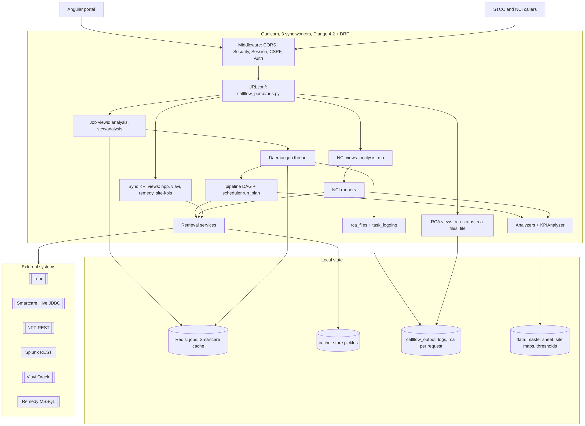

The portal and STCC never wait on the request thread: the view writes a job to Redis, starts a daemon thread and returns 202. That thread runs the DAG on a second thread pool, which calls the services, and pushes progress back into Redis while writing request-scoped RCA files to disk. NCI and the four thin KPI views do the same service calls inside the request, holding a sync worker for the whole run. The two Django databases are reached only by Django's own session, auth and admin apps.

## 2B. File and module dependency graph

Arrows read "imports". Solid arrows are module-level imports; dashed arrows are imports inside a function (resolved when that function first runs). Derived with an AST scan of all 108 modules, then checked by hand. No import cycles exist at either level.

### B1. Startup and routing

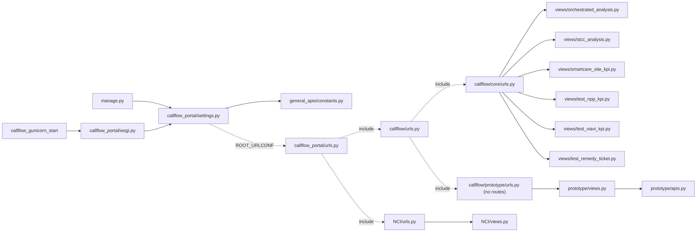

`include()` takes module paths as strings, so those edges come from Django's URL resolver, not Python imports. The prototype package is loaded at startup through its `urls.py` import but exposes no route.

### B2. Views to orchestration

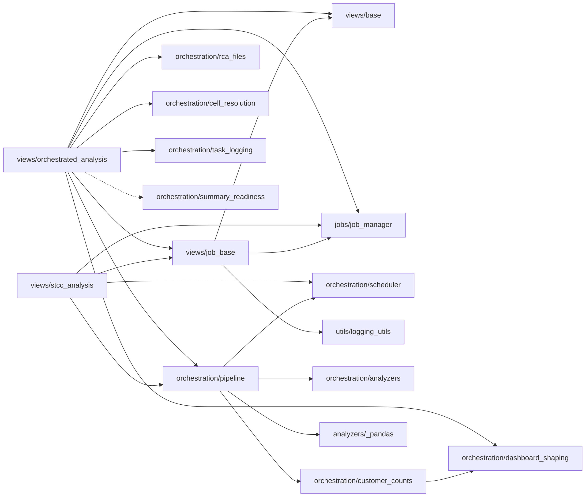

`pipeline.py` is the hub: 14 module-level imports, including every retrieval service (next graph). Its docstring says the service imports are deferred, but lines 35 to 59 import them at module level, so importing the pipeline loads pandas, JPype, cx_Oracle, pyodbc and trino.

### B3. Orchestration and analyzers to services

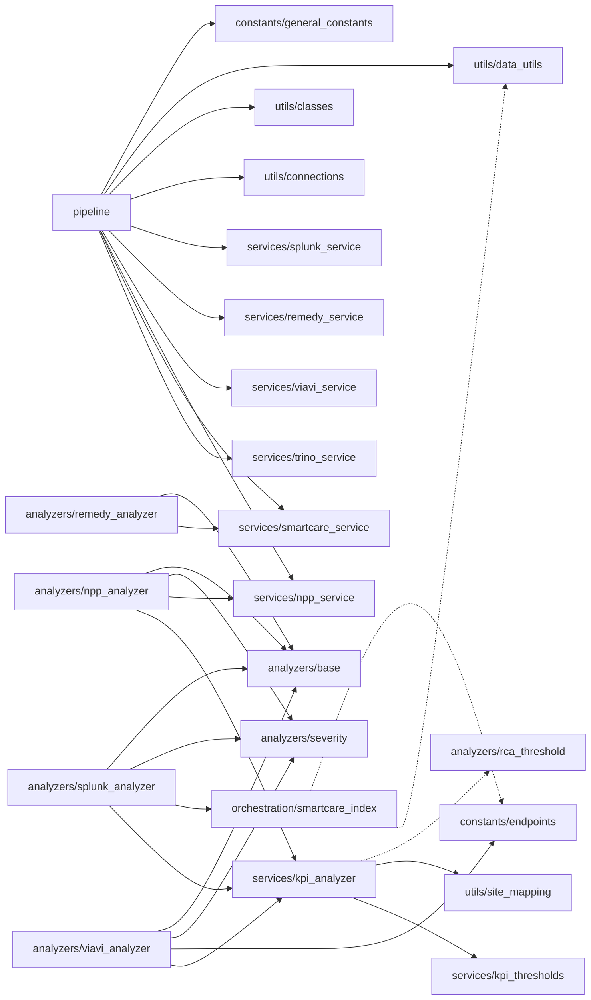

Two layering inversions, neither a cycle: `services/kpi_analyzer` reaches back up into `orchestration/analyzers/rca_threshold` (dashed, inside `_check_thresholds`), and `remedy_analyzer` borrows `calculate_top_remedy_with_subs` from the Smartcare service.

### B4. Services to data access, utilities and constants

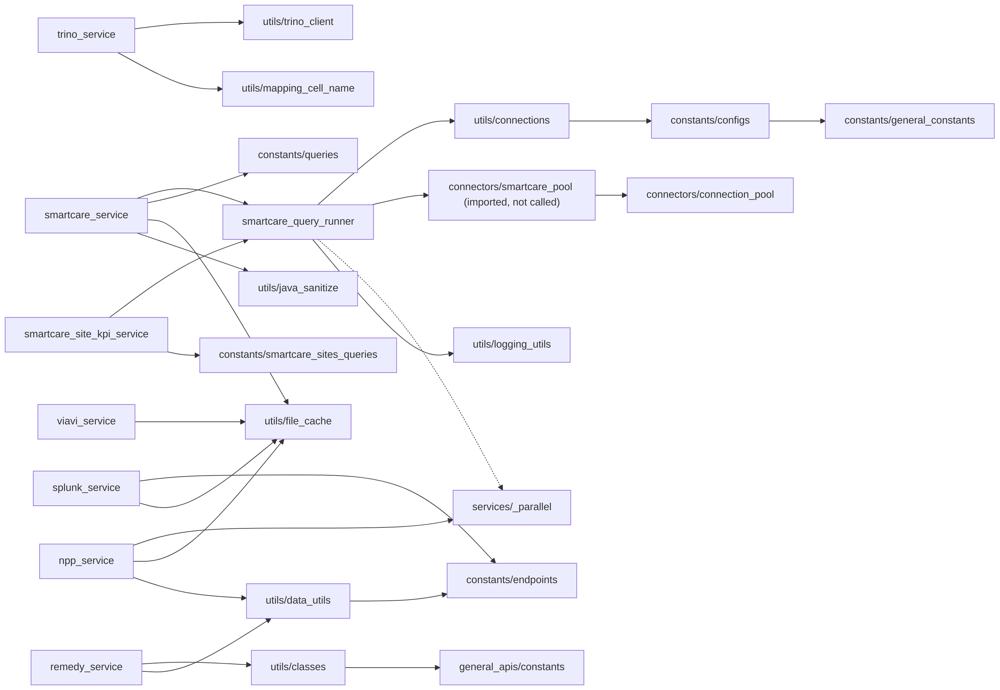

`utils/data_utils` has the highest fan-in in the codebase (11 importers), followed by `dashboard_shaping` (9), `analyzers/base` and `views/base` (7 each), and `file_cache` and `connections`. `core/utils/classes.py` imports `general_apis/constants.py`, a second copy of the constants that also exists as `core/constants/general_constants.py`.

### B5. NCI app

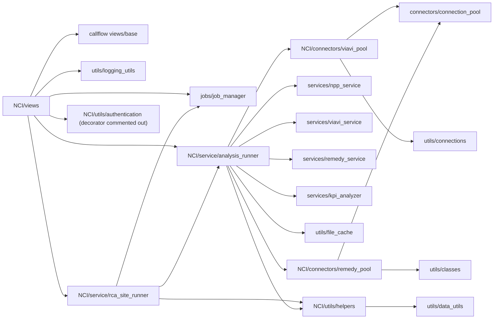

NCI does not use the DAG or the analyzers. It calls the same retrieval services and `KPIAnalyzer` directly, and it is the only caller of the connection pools.

## 2C. API execution flows

### C1. POST /callflow/api/analysis (portal)

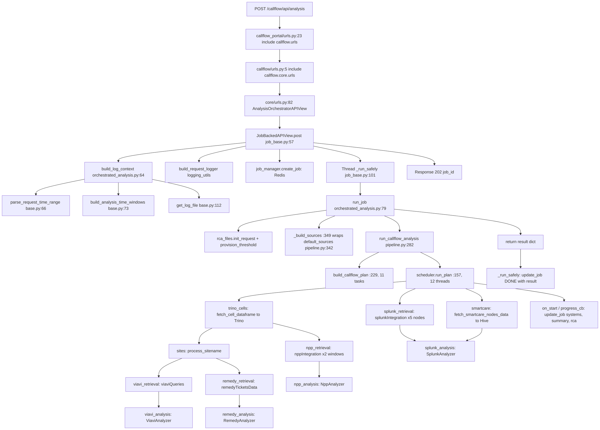

Validation errors in `build_log_context` (missing dates or MSISDNs, start after end) become 400 before any job exists. Everything else happens in the thread. Each wrapped retrieval also writes its RCA CSV and updates the manifest; each wrapped analysis streams `details` and `dashboard` into the job as soon as it finishes.

### C2. Polling and RCA file endpoints

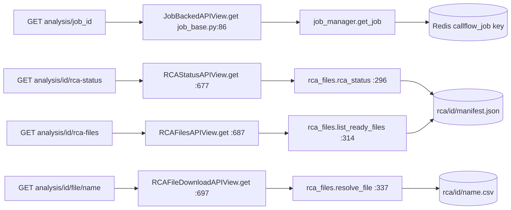

All four are cheap reads. `resolve_file` rejects path traversal in both the id and the filename. Route order in `core/urls.py` puts the three multi-segment RCA routes before the generic `analysis/{job_id}` route.

### C3. POST /callflow/api/stcc/analysis

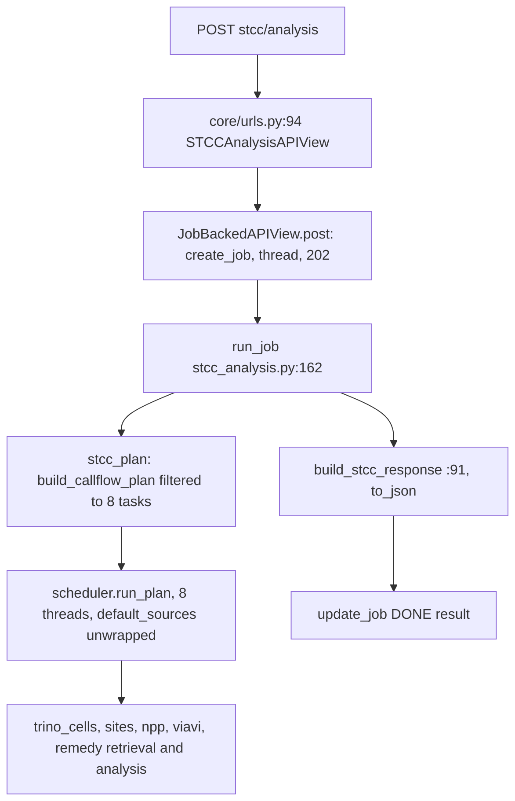

STCC uses the raw `default_sources()` without the portal wrappers, so it writes no RCA files, has no Trino-to-Smartcare cell fallback and never runs Smartcare or Splunk. The comment in `core/urls.py:93` calls it synchronous; the code is job-based.

### C4. POST /callflow/NCI/analysis/

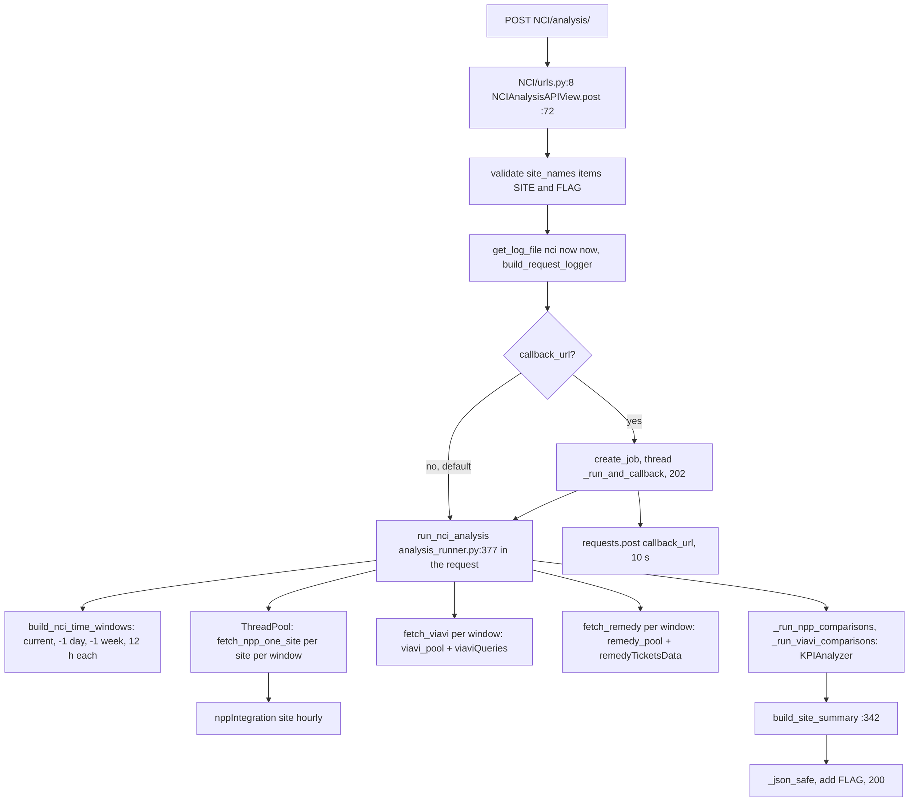

### C5. POST /callflow/NCI/rca/

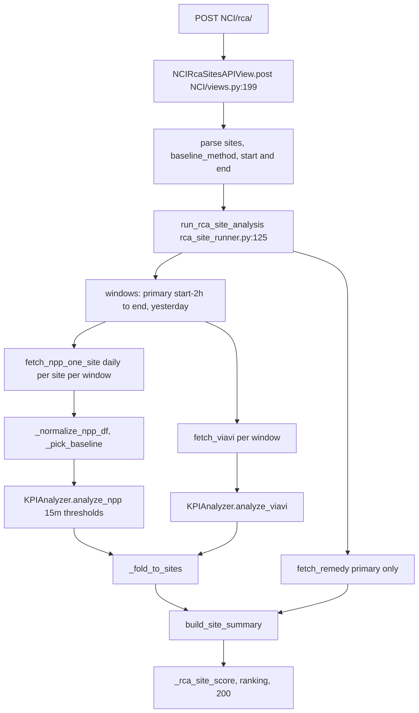

### C6. Thin KPI endpoints

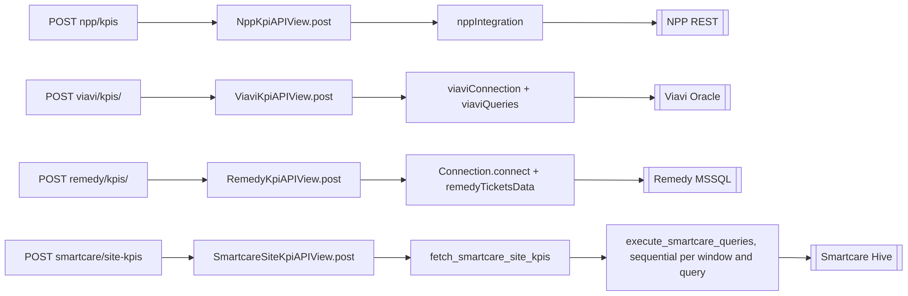

All four run inside the request. The Viavi and Remedy views set `conn = None` after use instead of closing it, and their `pool` variable is never assigned, so the invalidate branches never run.

## 2D. Function call graph

The functions that more than one endpoint depends on, with their callers. A change to anything in the middle column reaches every endpoint on the left that connects to it.

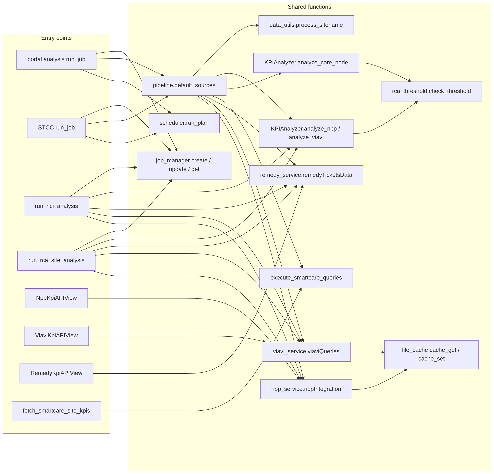

`default_sources` reaches Splunk via `splunkIntegration` and Smartcare via `fetch_smartcare_nodes_data`; only the portal analysis calls those. The process-wide semaphore `_NPP_HTTP_SLOTS` (10 concurrent requests, `npp_service.py:27`) is shared by every NPP caller in a worker, so a large NCI request can slow portal NPP retrieval running in the same worker.

#### Key call chains inside the portal analysis

| Task | Call chain (file:line) |
| --- | --- |
| trino_cells | `wrapped_get_cells` (orchestrated_analysis:422) → `get_cells` (pipeline:347) → `fetch_cell_dataframe` (trino_service:89) → `build_cell_query` (:57) → `run_trino_query` (trino_client:43); then `customer_counts_from_df` (trino_service:155), `cell_names_from_df` (:119), `cell_resolution.resolve_cells` (:52) |
| smartcare | `wrapped_smartcare` (:389) → `fetch_smartcare_nodes_data` (smartcare_service:308) → Redis cache check → `smartcareNodesQueries` (:51) → 2-hour chunks → `execute_smartcare_queries` (smartcare_query_runner:266) → `run_in_order` (\_parallel:18) → `run_single_query` (:97) → `smartcareConnection` (connections:14); then `process_smartcare_data` (:260) → `smartcareOutput_Aggregated`, `packet_nodes`, `calculate_subs_per_cell_site_handset` (Data only) |
| npp_retrieval | `retrieval_wrapper` (:371) → `retrieve_npp` (pipeline:392) → 2 windows in parallel → `_npp_fetch` (:385) → `nppIntegration` (npp_service:28) → `run_in_order` → `fetch_one` (:105) → `requests.post` |
| npp_analysis | `wrapped_npp_analysis` (:488) → `NppAnalyzer.analyze` (npp_analyzer:85) → `KPIAnalyzer.analyze_npp` (kpi_analyzer:264) → `_check_thresholds` (:142) → `rca_threshold.check_threshold`; `filter_entities_by_severity`; `calculate_affected_hub_taclac_metrics` (npp_service:198, reads the master sheet); `shape_npp_abnormal` with `_npp_chart_series` (pipeline:433) |
| splunk_retrieval / analysis | `retrieve_splunk` (pipeline:491) → 5 nodes in parallel → `splunkIntegration` (splunk_service:38) → 5 KPI threads per node (DSC: 4 regions × 5) → `requests.get`. Analysis: `SplunkAnalyzer.analyze` (splunk_analyzer:80) → `analyze_core_node` (kpi_analyzer:210) → severity gate → `SmartcareIndex.splunk_subs_mapper` (smartcare_index:142) → `shape_splunk_abnormal` |
| viavi / remedy | `retrieve_viavi` (pipeline:465) → `viaviConnection` + `viaviQueries`; `retrieve_remedy` (:479) → `Connection.connect` + `remedyTicketsData`; analyzers → `KPIAnalyzer.analyze_viavi` (:350), `calculate_top_remedy_with_subs` (smartcare_service:383), `shape_remedy` |

## 2E. Data flow

From the portal request body to what Angular and the RCA tool receive. Cylinders are data at rest; everything else is in memory inside the job thread.

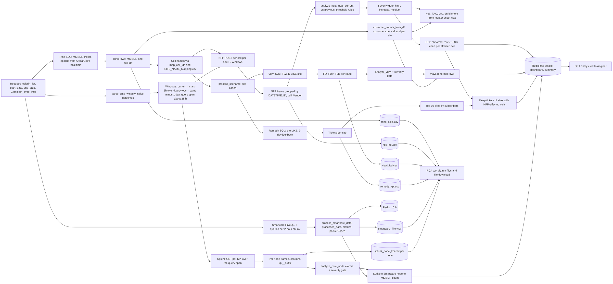

**Validation** happens only at the edge: `parse_time_window` (format and start before end) and a non-empty `msisdn_list`. MSISDN format rules in `smartcare_Validation_Inputs` are used only by the unrouted prototype. **Transformations** that matter for debugging: Trino times are localised to Africa/Cairo (`trino_service._epochs`), Smartcare uses the naive string in HiveQL `unix_timestamp()`, Viavi uses a 12-hour `AM/PM` string, Splunk uses `%m/%d/%Y:%H:%M:%S`. The RCA tool reads the CSVs, not the analysed results, and applies `data/thresholds.xlsx`, while the backend applies the Python dicts in `kpi_thresholds.py`. That split is one source of portal-vs-RCA differences.

## 2F. External integration dependency graph

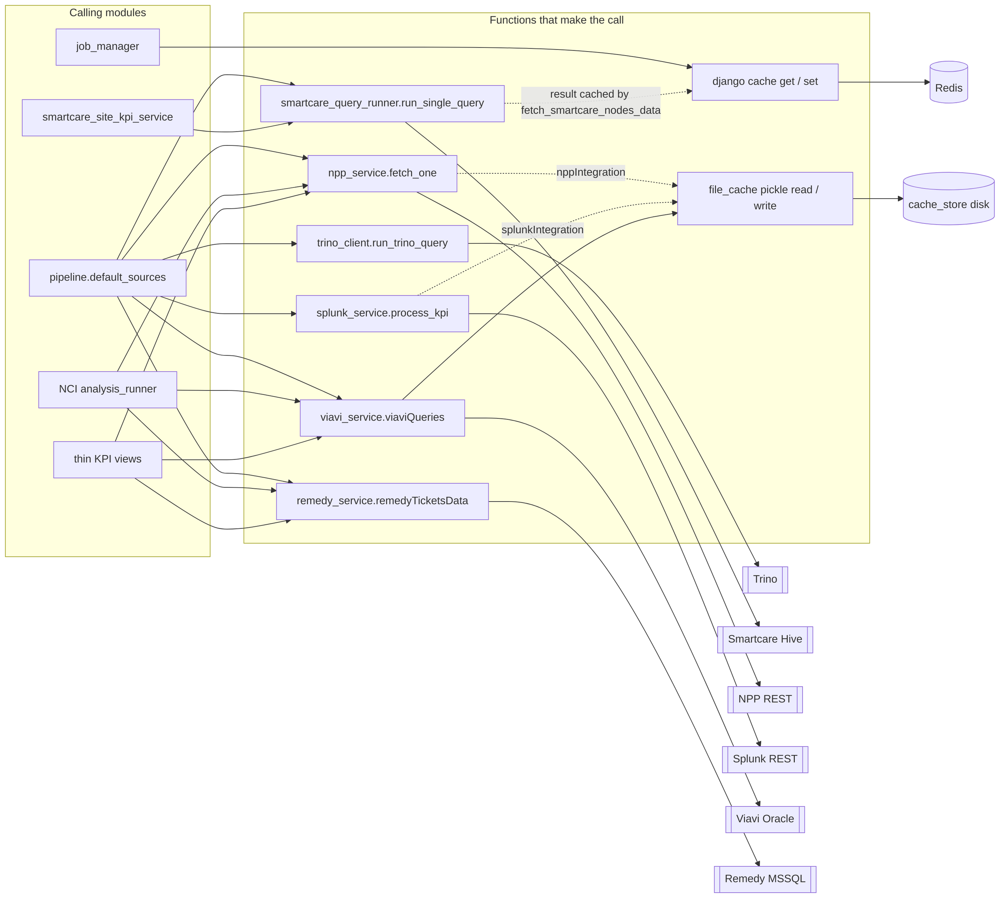

| System | Call made by | Sends / receives | Who depends on the result | Slow | Unavailable | Invalid or partial data |
| --- | --- | --- | --- | --- | --- | --- |
| **Trino** `10.230.180.66:8443`, basic auth, `verify=False` | `run_trino_query` via `fetch_cell_dataframe` (portal, STCC) | SQL over `hive.smartcare.npl_4g`, `iceberg…npl_attach_4g`, `…npl_ho_4g` with the MSISDN list and epoch range / rows of MSISDN and cell ids | sites, NPP, Viavi, Remedy retrieval; customer counts for every analysis; `trino_cells.csv` | No query timeout; only the 1800 s task deadline. Smartcare and Splunk keep running; everything else waits. | One retry with a fresh connection, then `trino_cells` FAILED and the 7 tasks downstream of it (sites, NPP, Viavi, Remedy retrieval and analysis) SKIPPED. | Zero cells: waits up to 110 s for Smartcare and reuses its `cell_name` column (portal only). |
| **Smartcare** Hive via JDBC (jaydebeapi + JPype) | `run_single_query` via `execute_smartcare_queries` (portal Smartcare task, site-kpis) | HiveQL templates with MSISDN tuple, `unix_timestamp` range, day-numbered table / CDR rows (Java types converted) | Splunk analysis (subscriber mapping), Smartcare card, packet nodes, handset types, `smartcare_filter.csv`, Trino-empty fallback | Socket timeout 30 min; task 1800 s. Splunk analysis waits for it. | A failed query returns an empty frame. Only if every query is empty does the task raise "No Smartcare data returned". | One failed query (for example S1-MME) is invisible to the task status; the columns it would have added are just missing. |
| **NPP** `10.241.161.227:3000/get-kpis/…`, bearer token | `fetch_one` via `nppIntegration` (portal, STCC, NCI, npp/kpis) | JSON `{cellName or site, hour}` per entity per hour / CSV of 15-min or hourly KPIs | NPP analysis, NPP cards, abnormal chart, Remedy site filter, `npp_kpi.csv` | (10 s, 60 s) per request, 5 threads per call, 10 per worker process; task 600 s, then TIMEOUT and "NPP processing failed". | Raises only if every request failed; otherwise missing hours are dropped. | Unparseable CSV counts as a failed request; empty CSV counts as empty. |
| **Splunk** REST URLs in `SPLUNK_ENDPOINTS` | `process_kpi` via `splunkIntegration` (portal only) | GET per KPI with time placeholders replaced / CSV time series | Splunk analysis, per-node `splunk_*_kpi.csv` | 60 s per KPI, 5 threads per node, 5 nodes in parallel; task 600 s. | A node raises only if every KPI failed; that node is dropped and the others continue. | Missing time column falls back to the first column; a failed merge drops that KPI with a log line. |
| **Viavi** Oracle via cx_Oracle | `viaviQueries` (portal, STCC, NCI, viavi/kpis) | SQL on `ONEADM."vw_VIAVI_Ethernet_Raw"` with `FLWID LIKE '%site%'` / FD, FDV, FLR rows | Viavi analysis, transport card, `viavi_kpi.csv` | No query timeout; task 600 s. | Connection error raises; task FAILED. | Missing expected columns raise; task FAILED. |
| **Remedy** MSSQL via pyodbc | `remedyTicketsData` (portal, STCC, NCI, remedy/kpis) | SQL on `Mobile_Squad.dbo.Remedy_Tickets`, 7-day lookback, `site LIKE` / tickets | Remedy analysis and card | No query timeout; task 600 s. | "Connection Failed" raises; task FAILED. | No rows returns `({}, 0)`. |
| **Redis** `127.0.0.1:6379/1` | `job_manager`, `fetch_smartcare_nodes_data` | Pickled job dicts and Smartcare results | Every job endpoint, every poll | Blocks the caller. | POTENTIAL `create_job` raises and the POST returns 500; failures inside the job thread depend on where they are raised. | Expired job: GET returns 404 and `update_job` silently no-ops. |

## 2G. Runtime sequence diagrams

### G1. Portal analysis, end to end

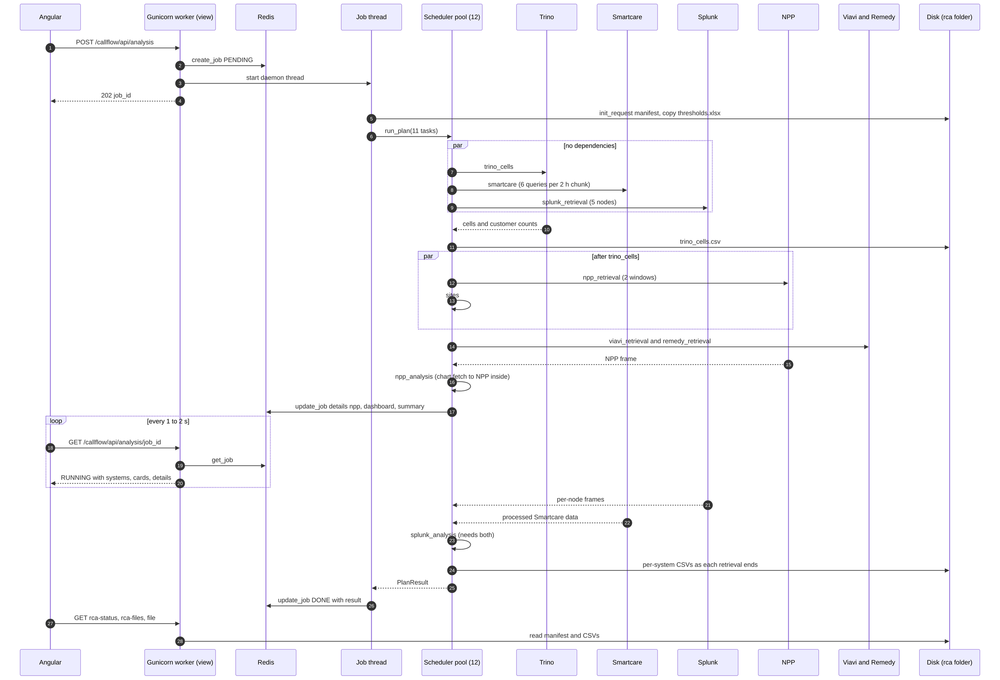

Steps 6 to 8 start together because those three tasks have no dependencies. Viavi and Remedy also wait for the `sites` task. NPP, Viavi and Remedy analyses never wait for Smartcare; only Splunk analysis does.

### G2. A task that times out

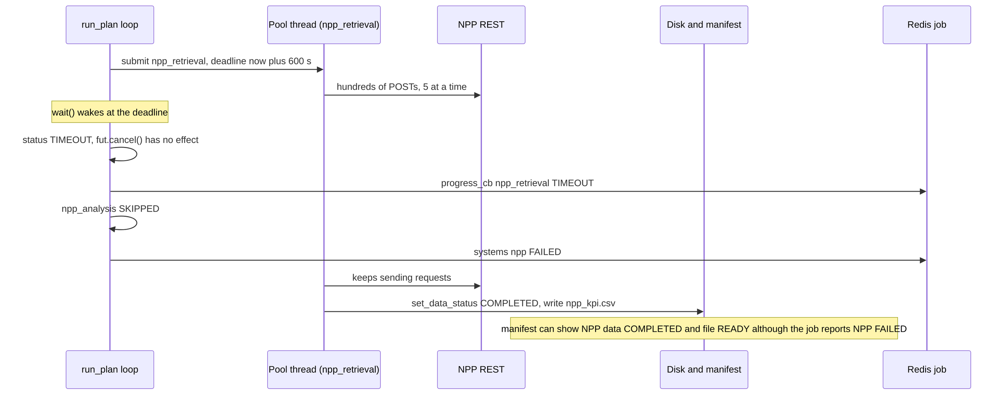

VERIFIED `scheduler.py:303-315` abandons the future, and `retrieval_wrapper` (`orchestrated_analysis.py:371`) has no check for a cancelled task, so the abandoned thread finishes its work and writes the file. Today's NPP change cut retrieval for 48 cells from 1,344 requests to 384 (plus 28 per affected cell for charts), which makes this much less likely, but the mechanism is unchanged.

### G3. NCI analysis (default synchronous mode)

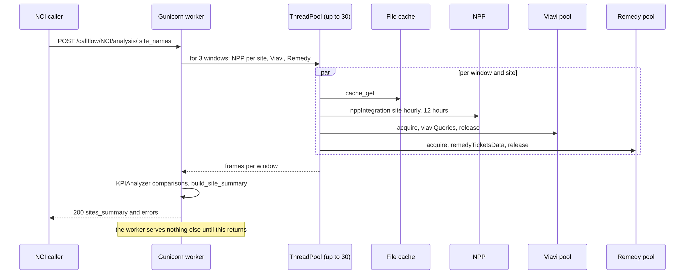

## 3. Dependency, execution-order and risk analysis

Each item names the file and line it was read from. VERIFIED means the behaviour follows directly from the code. POTENTIAL means the code path is real but how much it matters needs a runtime measurement.

### Defects found while tracing

DEFECT

Smartcare reads the wrong day's table after midnight

`smartcareNodesQueries` (`smartcare_service.py:66`) computes `tablename` once from the window start, then splits the window into 2-hour chunks that all reuse it. A complaint window that crosses 00:00 queries the previous day's tables for the hours after midnight. `smartcare_site_kpi_service._run_window` splits on the date boundary correctly, so the intended behaviour is clear.

DEFECT

A failed Smartcare query is reported as success

`run_single_query` returns an empty DataFrame on any error (`smartcare_query_runner.py:205`) and `execute_smartcare_queries` concatenates whatever came back. The Smartcare task only fails when every query is empty. This is how request `da5f17cdcf4b469e` lost its S1-MME columns while Smartcare showed COMPLETED. Today's Splunk fix keeps those alarms visible as unverified, but the Smartcare card and the packet-node popup still have no signal that data is missing.

DEFECT

Smartcare "retry once" never retries, and the failure log can crash

The docstring of `run_single_query` promises one retry, but `max_retries=1` gives exactly one attempt (`:129`). If `smartcareConnection` itself fails, the error log on line 204 references `query`, which was never assigned, so that log line raises `UnboundLocalError` (the real error is still logged on line 201).

DEFECT

The Trino-to-Smartcare cell fallback gives up too early

`FALLBACK_WAIT_SECONDS = 110` (`orchestrated_analysis.py:54`) is commented as "just under the trino task timeout", but that timeout is now 1800 s. Smartcare took 192 s in the last request you sent, so when Trino returns no cells the fallback times out before Smartcare finishes and the whole analysis fails.

DEFECT

Timed-out tasks keep writing results

See G2. After a TIMEOUT the abandoned thread still runs `retrieval_wrapper`, which marks the data COMPLETED and writes the CSV, so the RCA manifest can disagree with the job's system status.

DEFECT

Splunk state is computed before the subscriber mapping

`SplunkAnalyzer.analyze` derives the state from `alarms_by_node` (`splunk_analyzer.py:117-122`), not from the mapped `abnormal` list, so the state can be SUCCESS_WITH_ABNORMAL_KPIS while the list the portal draws is empty.

DEFECT

Voice complaints get no packet-node or handset metrics

In `process_smartcare_data` (`smartcare_service.py:285-288`) the Voice branch only copies the frame; `packet_nodes` and `calculate_subs_per_cell_site_handset` run in the Data branch only. `smartcare_nodes_Voice` also has no S1-MME device-info query.

DEFECT

Two Splunk KPIs are silently overwritten

`SPLUNK_ENDPOINTS` (`constants/endpoints.py:6`) defines `GGSN_CPU` and `GGSN_Throughput` twice each. Python keeps the second definition, so 105 written entries become 103 KPIs.

VERIFIED

NCI endpoints are open and can call any URL

`@method_decorator(require_api_token)` is commented out on both NCI views (`NCI/views.py:56`, `:183`), DRF has no default permission set, and `callback_url` is POSTed to without any allow-list, so any client that can reach the server can make it send a request to any address it chooses.

VERIFIED

Credentials in source files

Trino user and password (`utils/trino_client.py`), NPP bearer token (`services/npp_service.py`), MSSQL `sa` password (`general_apis/constants.py` and `core/constants/general_constants.py`), Postgres password (`settings.py:139`), Eniq credentials (`utils/connections.py`) and prototype mediation credentials. Values are deliberately not reproduced here.

VERIFIED

Database connections are opened and not closed

`pipeline.retrieve_viavi` (`:465`) and `retrieve_remedy` (`:479`) open a new Oracle and ODBC connection per request and never close it; the two KPI views set `conn = None` instead of closing. Release then depends on garbage collection.

### Performance: execution order, blocking calls and bottlenecks

#### Measured in your logs (request da5f17cdcf4b469e, 48 cells)

| Stage | Duration | Status | Cause in code |
| --- | --- | --- | --- |
| npp_retrieval | 600 s (TIMEOUT) | Fixed today | Fetched 28 h for 48 cells (1,344 POSTs). Now 384 POSTs for the two analysis windows plus 28 per affected cell for charts. |
| smartcare | 192 s | Open | A batch takes as long as its slowest query; in that run the S1-MME query failed after 120 s and the task still reported success. |
| trino_cells | 105 s | Open | Single SQL over three Hive/Iceberg tables; no query timeout. Blocks NPP, Viavi and Remedy. |
| splunk_retrieval | 77 s | Open | One GET per KPI (103 defined; DSC KPIs once per region × 4), 5 at a time per node, 60 s timeout each. |

#### Found in the code

VERIFIED

Synchronous endpoints share three sync workers

Gunicorn runs 3 sync workers. The NCI endpoints (default mode), `smartcare/site-kpis`, `npp/kpis`, `viavi/kpis/` and `remedy/kpis/` do all their external I/O inside the request. Three such calls at once leave no worker to answer the portal's polls. POTENTIAL impact depends on how often NCI is called.

VERIFIED

Sequential loops that could run in parallel

Smartcare 2-hour chunks run one after another (`smartcare_service.py:89`); a 1-hour complaint is one chunk, so this only matters for longer windows. `fetch_smartcare_site_kpis` runs 3 windows × 2 queries × up to 2 day-chunks one after another, up to 12 Hive queries in the request. The NPP chart fetch handles affected cells one at a time (each cell's 28 requests are parallel), bounded by the 120 s budget.

POTENTIAL

The master sheet is re-read on every NPP analysis

`calculate_affected_hub_taclac_metrics` calls `pd.read_excel(MASTER_SHEET_PATH)` (`npp_service.py:238`, a 1.3 MB workbook) each time there are affected cells; nothing caches it. Site mapping (`utils/site_mapping.py`) is cached per process, which shows the pattern to copy. Measure before changing.

POTENTIAL

Connection setup on every call

Smartcare opens a new JDBC connection for every query (6 per chunk, by design per the comment at `smartcare_query_runner.py:134`); the Smartcare pool exists but is never called. Viavi and Remedy open a new connection per portal request while NCI pools them. Trino goes the other way: one `lru_cache`d connection is shared by every thread and request.

POTENTIAL

Poll responses grow with the analysis

`GET /callflow/api/analysis/{id}` returns the whole job, including `details.abnormal` with every chart series, every 1 to 2 seconds per open portal tab.

POTENTIAL

Job record can expire during a long Smartcare run

Job TTL is 30 min, refreshed on each update (`job_manager.py:37`). Smartcare's task timeout is also 30 min. If Smartcare is the only task left and runs that long without any update, the job expires: polls return 404 and the final DONE update is dropped.

### Race conditions and shared state

VERIFIED

Lost updates on the job record

`update_job` does get, merge, set with no lock (`job_manager.py:64-72`). In the portal job it is called from scheduler callbacks under `lock`, from `push_details` under `details_lock` and from `merge_dash` under `dash_lock`, which are three different locks, so two threads can each read the old record and the later write erases the earlier one's field. Later pushes resend full objects, so the effect is usually a stale poll rather than lost data. POTENTIAL frequency.

VERIFIED

Log handlers accumulate for the life of the worker

`build_request_logger` attaches a `FileHandler` to `callflow.request.{id}` and nothing ever removes it. `smartcareNodesQueries` calls `execute_smartcare_queries` without a logger, so `_fallback_logger` builds a new logger with a millisecond id for every chunk (`smartcare_query_runner.py:62`). `get_system_logger` adds six more per portal request. Open file handles and logger objects grow with every request until the worker restarts. POTENTIAL whether the process file-handle limit is reached.

VERIFIED

Request logs are keyed by time window, not by request

`get_log_file` returns one file per prefix (`logs/orchestrated.txt`, `logs/nci.txt`) and `ts = "{start}_{end}"`; that `ts` is the logger id. Two portal requests for the same window share a logger, and every NCI request uses the id `now_now`. The per-request files under `rca/{request_id}/logs/` are the reliable place to read one request.

VERIFIED

Shared output file names

Debug dumps are named by window, not request: `sc_nodes_{view}_{category}_filter_{ts}.xlsx` (`smartcare_service.py:371`), `remedy_kpi_{start}_{end}.csv` (`remedy_service.py:31`), `matched_master_{ts}.csv` (`npp_service.py:299`). Concurrent requests for the same window overwrite each other. The RCA tool does not read these files.

POTENTIAL

Other shared state

The pickle file cache writes straight to the final path, so a concurrent reader can see a partial file; it is treated as a miss. `_summary_snapshot` copies `details` under the status lock, not `details_lock`; a concurrent change makes it return an empty card set for that push. Two Smartcare callers in one worker could both try a cold `jpype.startJVM()`; `run_in_order(first_sync=True)` only protects one call. Module caches (`_SITE_MAPPING`, `_SITE_PHY_TO_CIDS`) load without a lock, which only risks a double load.

### Duplication, coupling and shared functions

| Duplicate | Where | Risk |
| --- | --- | --- |
| Two threshold sources | `services/kpi_thresholds.py` (backend) and `data/thresholds.xlsx` (RCA tool) | Portal and RCA results drift whenever one is edited. |
| Byte-identical `classes.py` | `general_apis/classes.py` and `callflow/core/utils/classes.py` | Fixes land in one copy only. |
| Near-identical constants | `general_apis/constants.py` and `core/constants/general_constants.py` | `settings.py` and `utils/classes.py` read one copy, the services the other. |
| NCI time windows | `NCI/utils/helpers.build_nci_time_windows` and `services/smartcare_site_kpi_service.build_nci_time_windows` (+ `_round_down`) | Window rules diverge. |
| Splunk to Smartcare mapping | `SmartcareIndex.splunk_subs_mapper` (live), `analyzers/_pandas.splunk_subs_mapper` and `data_utils.map_splunk_kpi_to_smartcare` (unused) | Today's case-insensitive fix exists only in the live one. |
| JSON-safe converters | `NCI/views._json_safe`, `stcc_analysis.to_json`, `test_remedy_ticket._json_safe` | Different NaN and timestamp handling per endpoint. |
| Datetime parsers | `_parse_dt` in three KPI views and `NCI/views.py`; `parse_time_window` in `views/base.py` | Different accepted formats per endpoint. |
| Severity ranking | `analyzers/severity.SEVERITY_RANK` and `NCI/service/analysis_runner._SEVERITY_RANK` | Kept in sync by hand. |
| Task names as strings | `pipeline.T_*`, `summary_readiness` constants, the order list in `orchestrated_analysis.py:314` | Renaming a task breaks cards silently. |
| Legacy copies | `Shourok_Code.py` (1,835 lines), `callflow/prototype/services/kpi_analyzer.py` and `kpi_thresholds.py` | Search results point to stale logic. |

**Tightly coupled modules.** `views/orchestrated_analysis.py` owns job streaming, dashboard mapping, RCA file extraction and the cell fallback in one 705-line class, and depends on the exact dict shape every analyzer returns. `orchestration/pipeline.py` imports every retrieval service and is the only place the DAG is defined; STCC reuses it by filtering task names. `services/kpi_analyzer.py` is called by every analysis path (portal, STCC, NCI, NCI RCA), so any threshold or aggregation change moves all four at once.

**Shared functions with the widest reach.** `nppIntegration`, `viaviQueries` and `remedyTicketsData` each serve 4 to 5 endpoints. `KPIAnalyzer.analyze_npp` and `analyze_viavi` serve 4. `process_sitename` decides which sites Viavi and Remedy query, so it shapes their results for the portal, STCC and NCI. `job_manager` backs every async endpoint.

### Unused and unreachable code

Method: import reachability from `settings.py`, `wsgi.py`, `manage.py` and every URLconf (both module-level and in-function imports), then a search for `importlib`, `__import__`, signals, `AppConfig.ready`, management commands and schedulers (none exist), then a name search across all files for each top-level function.

| Item | Status |
| --- | --- |
| `Shourok_Code.py` | Not imported by anything; standalone legacy script. |
| `services/dqi_service.py` + `constants/DQI_queries.py` | Unreachable; the `dqi` route is commented out. |
| `services/smartcare_failure_service.py` + `constants/smartcare_failure_queries.py` | Unreachable; the `smartcare-failure` route is commented out. |
| `services/complain_reports.py` | Unreachable; the `complaint-report` route is commented out. |
| `utils/permissions.py` | Unreachable. |
| `NCI/service/portal_result.py`, `NCI/service/npp_service.py`, `NCI/api_key_auth.py` (empty) | Unreachable. |
| `callflow/prototype/views.py`, `apis.py`, `services/*` | Loaded at startup, but the prototype URLconf has no routes. |
| `connectors/smartcare_pool.get_smartcare_pool` | Imported by the query runner, called only in commented-out code. |
| `analyzers/smartcare_analyzer.SmartcareAnalyzer` | Exported, never instantiated. |
| Unreferenced functions | `smartcareRateQueries`, `voice_specific_aggregation`, `remedy_ticket`, `get_cell_names`, `Eniq_Connection`, `cache_delete`, `cache_clear_expired`, `get_4g_site_names`, `shape_npp_data`, `rca_threshold.find_config`, `pipeline._smartcare_processed`, `pipeline._smartcare_metrics`, `_dash_remedy`, `_dash_npp_UNUSED`, `analyzers/_pandas.splunk_subs_mapper`. |
| `callflow_portal/asgi.py` | Framework entry point; unused by the current Gunicorn script but not dead code. |

No import cycles exist, either at module level or including in-function imports.

## 4. Dependency matrix

Importer and dependency lists are generated from the AST scan (both import kinds) and use short names: `orch.` = `callflow.core.orchestration.`, `an.` = `analyzers.`. The other columns were filled in by reading each file. The table scrolls sideways.

| Module / file | Responsibility | Imported by | Dependencies | Important functions / classes | Database | External systems | Related endpoints | Potential risks |
| --- | --- | --- | --- | --- | --- | --- | --- | --- |
| callflow_portal/settings.py | Django settings, env loading, DBs, cache, CORS, paths | - | general_apis.constants | INSTALLED_APPS, MIDDLEWARE, DATABASES, CACHES, OUTPUT_DIR | Postgres default, MSSQL CORE_NW_KPIS | Redis | All | DEBUG=True; hardcoded DB password; no LOGGING; DRF defaults to AllowAny |
| callflow/core/urls.py | Portal API routes | - | views.orchestrated_analysis, views.smartcare_site_kpi, views.stcc_analysis, views.test_npp_kpi, views.test_remedy_ticket, views.test_viavi_kpi | urlpatterns | - | - | All /callflow/api/\* | \~20 commented-out routes; route order matters for analysis/{id}/… |
| NCI/urls.py | NCI routes | - | NCI.views | urlpatterns | - | - | /callflow/NCI/\* | - |
| callflow/core/views/base.py | Base view: time parsing, analysis windows, log file path | NCI.views, views.job_base, views.orchestrated_analysis, views.smartcare_site_kpi, views.test_npp_kpi, views.test_remedy_ticket, views.test_viavi_kpi | - | BaseCallFlowAPIView, parse_time_window, build_analysis_time_windows, get_log_file | - | Disk (logs) | All except admin | Log file is shared per prefix; ts derived from the window, not the request |
| callflow/core/views/job_base.py | Job pattern: create job, start thread, poll | views.orchestrated_analysis, views.stcc_analysis | jobs.job_manager, utils.logging_utils, views.base | JobBackedAPIView.post/get/\_run_safely | - | Redis via job_manager | analysis, stcc/analysis | Daemon threads die with the worker; no concurrency limit per worker |
| callflow/core/views/orchestrated_analysis.py | Portal analysis job; wraps sources for RCA files, dashboard, details; RCA endpoints | urls | jobs.job_manager, orch.cell_resolution, orch.dashboard_shaping, orch.pipeline, orch.rca_files, orch.summary_readiness, orch.task_logging, orch.task_logging, views.base, views.job_base | AnalysisOrchestratorAPIView.run_job, \_build_sources, RCAStatus/Files/FileDownload views | - | Redis, Disk | analysis, analysis/{id}, rca-status, rca-files, file | Highest coupling; lost-update race on job; abandoned tasks still write files; fallback wait 110 s |
| callflow/core/views/stcc_analysis.py | STCC job: DAG subset for NPP/Viavi/Remedy | urls | jobs.job_manager, orch.pipeline, orch.scheduler, views.job_base | STCCAnalysisAPIView.run_job, stcc_plan, build_stcc_response | - | via services | stcc/analysis | No cell fallback; urls comment says synchronous |
| callflow/core/views/test_npp_kpi.py | Raw NPP rows | urls | services.npp_service, views.base | NppKpiAPIView.post | - | NPP | npp/kpis | Synchronous in the worker |
| callflow/core/views/test_viavi_kpi.py | Raw Viavi rows | urls | services.viavi_service, utils.connections, views.base | ViaviKpiAPIView.post | - | Viavi | viavi/kpis/ | Connection never closed; dead pool branch |
| callflow/core/views/test_remedy_ticket.py | Raw Remedy tickets | urls | constants.general_constants, services.remedy_service, utils.classes, views.base | RemedyKpiAPIView.post | - | Remedy MSSQL | remedy/kpis/ | Connection never closed; dead pool branch |
| callflow/core/views/smartcare_site_kpi.py | Smartcare site KPIs | urls | services.smartcare_site_kpi_service, views.base | SmartcareSiteKpiAPIView.post | - | Smartcare | smartcare/site-kpis | Up to 12 sequential Hive queries inside the request |
| callflow/core/jobs/job_manager.py | Job state in Django cache | NCI.service.analysis_runner, NCI.service.rca_site_runner, NCI.views, views.job_base, views.orchestrated_analysis, views.stcc_analysis | - | create_job, update_job, get_job | - | Redis | All job endpoints, NCI async | Read-modify-write without lock; 30 min TTL can expire during long jobs |
| callflow/core/orchestration/scheduler.py | Generic DAG runner | orch.pipeline, orchestration, views.stcc_analysis | - | run_plan, Task, TaskOutcome, PlanResult | - | - | analysis, stcc/analysis | Timed-out threads keep running |
| callflow/core/orchestration/pipeline.py | CallFlow DAG, data sources, status roll-up | views.orchestrated_analysis, views.stcc_analysis | constants.general_constants, orch.an.\_pandas, orch.analyzers, orch.customer_counts, orch.scheduler, services.npp_service, services.remedy_service, services.smartcare_service, services.splunk_service, services.trino_service, services.viavi_service, utils.classes, utils.connections, utils.data_utils | build_callflow_plan, run_callflow_analysis, default_sources, rollup_all, classify_overall | - | All six via services | analysis, stcc/analysis | Hub module (14 imports); Viavi/Remedy connections not closed; docstring says lazy imports but they are module-level |
| callflow/core/orchestration/analyzers/npp_analyzer.py | NPP analysis contract | orch.analyzers | orch.an.\_pandas, orch.an.base, orch.an.severity, orch.customer_counts, orch.dashboard_shaping, orch.task_logging, services.kpi_analyzer, services.npp_service | NppAnalyzer.analyze | - | NPP (chart fetch via provider) | analysis, stcc/analysis | Master sheet read on every run with affected cells |
| callflow/core/orchestration/analyzers/splunk_analyzer.py | Splunk analysis contract | orch.analyzers | orch.an.\_pandas, orch.an.base, orch.an.severity, orch.dashboard_shaping, orch.smartcare_index, orch.task_logging, services.kpi_analyzer | SplunkAnalyzer.analyze | - | - | analysis | State counts alarms before Smartcare mapping |
| callflow/core/orchestration/analyzers/viavi_analyzer.py | Viavi analysis contract | orch.analyzers | constants.endpoints, orch.an.\_pandas, orch.an.base, orch.an.severity, orch.customer_counts, orch.dashboard_shaping, orch.task_logging, services.kpi_analyzer | ViaviAnalyzer.analyze | - | - | analysis, stcc/analysis | - |
| callflow/core/orchestration/analyzers/remedy_analyzer.py | Remedy ranking contract | orch.analyzers | orch.an.base, orch.customer_counts, orch.dashboard_shaping, services.smartcare_service | RemedyAnalyzer.analyze | - | - | analysis, stcc/analysis | Borrows a function from smartcare_service |
| callflow/core/orchestration/smartcare_index.py | Smartcare node index, Splunk subscriber mapping | orch.an.splunk_analyzer | constants.endpoints, orch.dashboard_shaping, utils.data_utils | SmartcareIndex.build, match_and_count, splunk_subs_mapper, from_context | - | - | analysis | Mapping table quality (mixed-case keys, name variants) |
| callflow/core/orchestration/dashboard_shaping.py | Pure shaping of frontend arrays | NCI.service.portal_result, orch.an.npp_analyzer, orch.an.remedy_analyzer, orch.an.smartcare_analyzer, orch.an.splunk_analyzer, orch.an.viavi_analyzer, orch.customer_counts, orch.smartcare_index, views.orchestrated_analysis | - | shape_npp_abnormal, shape_viavi_abnormal, shape_splunk_abnormal, shape_remedy, shape_smartcare_metrics | - | - | analysis, stcc/analysis | Shape changes affect Angular directly |
| callflow/core/orchestration/rca_files.py | Request-scoped RCA files and manifest | views.orchestrated_analysis | - | init_request, write_system_file(s), rca_status, list_ready_files, resolve_file | - | Disk | analysis, rca-status, rca-files, file | Per-request lock dict never pruned (small) |
| callflow/core/orchestration/task_logging.py | Structured per-request, per-system logs | orch.an.npp_analyzer, orch.an.splunk_analyzer, orch.an.viavi_analyzer, views.orchestrated_analysis | - | TaskEventLogger, StageLog, get_system_logger | - | Disk | analysis | File handlers never closed |
| callflow/core/services/kpi_analyzer.py | KPI threshold evaluation | NCI.service.analysis_runner, Shourok_Code, orch.an.npp_analyzer, orch.an.splunk_analyzer, orch.an.viavi_analyzer | orch.an.rca_threshold, services.kpi_thresholds, utils.site_mapping | KPIAnalyzer.analyze_npp, analyze_viavi, analyze_core_node | - | Disk (site mapping xlsx, once per process) | analysis, stcc, NCI analysis, NCI rca | Shared by every analysis path; Splunk previous value defaults to 0 |
| callflow/core/services/kpi_thresholds.py | Threshold rules as Python dicts | services.kpi_analyzer | - | KPIThresholds.get_thresholds_for_system | - | - | Same as kpi_analyzer | Separate from data/thresholds.xlsx used by the RCA tool |
| callflow/core/services/trino_service.py | Trino cell lookup and customer counts | orch.pipeline | utils.data_utils, utils.mapping_cell_name, utils.trino_client | fetch_cell_dataframe, cell_names_from_df, customer_counts_from_df | - | Trino | analysis, stcc/analysis | Single cached connection shared across threads |
| callflow/core/services/smartcare_service.py | Smartcare node retrieval and processing | orch.an.remedy_analyzer, orch.pipeline | constants.queries, services.smartcare_query_runner, utils.connections, utils.data_utils, utils.file_cache, utils.java_sanitize | fetch_smartcare_nodes_data, smartcareNodesQueries, process_smartcare_data, calculate_top_remedy_with_subs | - | Smartcare, Redis, Disk | analysis | Table suffix fixed at window start; Voice branch leaves metrics empty |
| callflow/core/services/smartcare_query_runner.py | Parallel Hive query execution | services.dqi_service, services.smartcare_failure_service, services.smartcare_service, services.smartcare_site_kpi_service | connectors.smartcare_pool, services.\_parallel, utils.connections, utils.data_utils, utils.logging_utils | execute_smartcare_queries, run_single_query | - | Smartcare JDBC | analysis, smartcare/site-kpis | Failed query becomes an empty frame; logger per call leaks handlers |
| callflow/core/services/npp_service.py | NPP REST client and hub/TAC/LAC enrichment | NCI.service.analysis_runner, orch.an.npp_analyzer, orch.pipeline, views.test_npp_kpi | services.\_parallel, utils.data_utils, utils.file_cache | nppIntegration, calculate_affected_hub_taclac_metrics | - | NPP, file cache, master sheet | analysis, stcc, NCI analysis, NCI rca, npp/kpis | Hardcoded token; process-wide semaphore shared by all callers |
| callflow/core/services/splunk_service.py | Splunk REST client | orch.pipeline | constants.endpoints, utils.file_cache | splunkIntegration | - | Splunk, file cache | analysis | verify=False; duplicate KPI keys in endpoint table |
| callflow/core/services/viavi_service.py | Viavi Oracle query | NCI.service.analysis_runner, orch.pipeline, views.test_viavi_kpi | utils.file_cache | viaviQueries | - | Viavi Oracle, file cache | analysis, stcc, NCI, viavi/kpis | SQL built by string formatting |
| callflow/core/services/remedy_service.py | Remedy ticket query | NCI.service.analysis_runner, orch.pipeline, views.test_remedy_ticket | constants.general_constants, utils.classes, utils.data_utils | remedyTicketsData | - | Remedy MSSQL | analysis, stcc, NCI, remedy/kpis | Shared CSV dump name per window |
| callflow/core/utils/connections.py | Smartcare JDBC, Viavi Oracle connections | NCI.connectors.viavi_pool, connectors.smartcare_pool, orch.pipeline, services.smartcare_query_runner, services.smartcare_service, views.test_viavi_kpi | constants.configs | smartcareConnection, viaviConnection | - | Smartcare, Viavi | Every Smartcare and Viavi caller | JVM started lazily; hardcoded Eniq credentials in unused function |
| callflow/core/utils/trino_client.py | Trino DB-API connection and query | services.dqi_service, services.trino_service | - | get_trino_connection, run_trino_query | - | Trino | analysis, stcc/analysis | Hardcoded credentials; verify=False |
| callflow/core/utils/classes.py | pyodbc Connection, file helpers, email | NCI.connectors.remedy_pool, orch.pipeline, services.remedy_service, views.test_remedy_ticket | general_apis.constants | Connection.connect/query_select/close | MSSQL | Remedy MSSQL | analysis, stcc, NCI, remedy/kpis | Identical copy in general_apis/classes.py |
| callflow/core/utils/data_utils.py | Site-name derivation, Java type conversion, Splunk suffix | NCI.utils.helpers, callflow.prototype.apis, orch.an.\_pandas, orch.pipeline, orch.smartcare_index, services.npp_service, services.remedy_service, services.smartcare_query_runner, services.smartcare_service, services.smartcare_site_kpi_service, services.trino_service | constants.endpoints | process_sitename, convert_java_types, extract_suffix | - | - | All analysis endpoints | Highest fan-in (11 importers) |
| callflow/core/utils/file_cache.py | Pickle cache on disk | NCI.service.analysis_runner, services.npp_service, services.smartcare_service, services.splunk_service, services.viavi_service | - | cache_get, cache_set, make\_\*\_cache_key | - | Disk cache_store | analysis, stcc, NCI, npp/kpis, viavi/kpis | Absolute path created at import; non-atomic writes |
| callflow/core/utils/logging_utils.py | Request identity and request loggers | NCI.views, services.smartcare_query_runner, utils.permissions, views.job_base | - | build_request_logger, get_request_identity, log_step | - | Disk | All job and NCI endpoints | Logger and FileHandler per id never closed |
| NCI/views.py | NCI endpoints | NCI.urls | NCI.service.analysis_runner, NCI.service.rca_site_runner, NCI.utils.authentication, jobs.job_manager, utils.logging_utils, views.base | NCIAnalysisAPIView, NCIRcaSitesAPIView | - | Callback URLs | NCI analysis, NCI rca | No auth; callback to any URL; shared logger id now_now |
| NCI/service/analysis_runner.py | NCI fetch, compare, site summary | NCI.service.portal_result, NCI.service.rca_site_runner, NCI.views | NCI.connectors.remedy_pool, NCI.connectors.viavi_pool, NCI.utils.helpers, jobs.job_manager, services.kpi_analyzer, services.npp_service, services.remedy_service, services.viavi_service, utils.file_cache | run_nci_analysis, fetch_npp_one_site, fetch_viavi, fetch_remedy, build_site_summary | - | NPP, Viavi, Remedy | NCI analysis, NCI rca | Synchronous by default; up to 30 threads per request |
| NCI/service/rca_site_runner.py | Server-side RCA scoring for sites | NCI.views | NCI.service.analysis_runner, NCI.utils.helpers, jobs.job_manager | run_rca_site_analysis, \_pick_baseline, \_fold_to_sites, \_rca_site_score | - | NPP, Viavi, Remedy | NCI rca | Scoring constants mirror the HTML tool by hand |

## 5. How it fits together

### 1. How the backend starts

Gunicorn imports `callflow_portal.wsgi`, which loads `settings.py`. Settings read `.env` into module constants, star-import `general_apis/constants.py`, register the `callflow` and `NCI` apps, configure Redis as the cache and point `ROOT_URLCONF` at `callflow_portal/urls.py`. When the URLconf is first resolved, every view module and, through `pipeline.py`, every service, driver library and the pickle cache directory are imported. Nothing connects to an external system at startup: Trino connects on its first query and Smartcare starts the JVM on its first connection, separately in each of the 3 workers.

### 2. How a request travels

CORS and the standard Django middleware run, the URL resolver picks a DRF `APIView`, and the view either answers directly (RCA reads, KPI views, NCI default mode) or follows the job pattern: validate in `build_log_context`, write a PENDING job to Redis, start a daemon thread, return 202. The thread runs `run_job`, which for the portal executes the 11-task DAG on a 12-thread pool. Each task calls a service, the service calls an external system, the wrappers in `_build_sources` write the RCA CSV and stream results into the Redis job, and the frontend sees them on its next poll.

### 3. Where the core business logic lives

KPI rules and comparisons: `services/kpi_analyzer.py` with `kpi_thresholds.py` and `orchestration/analyzers/rca_threshold.py`. Per-system interpretation (severity gate, enrichment, customer counts, state): the four analyzers in `orchestration/analyzers/`. Frontend shapes: `orchestration/dashboard_shaping.py`. Data rules that change results silently: `trino_service.customer_counts_from_df`, `data_utils.process_sitename`, `smartcare_service.process_smartcare_data`, `smartcare_index.splunk_subs_mapper`. NCI keeps its own comparison and scoring logic in `NCI/service/`.

### 4. How data access is organised

There is no ORM layer. Each external system has one connection function (`trino_client`, `connections.smartcareConnection` and `viaviConnection`, `classes.Connection`) and one query function in `services/` that builds SQL or HTTP payloads by string formatting and returns a pandas DataFrame. Two cache layers sit in front: Redis for Smartcare results and job state, and a pickle directory for NPP, Splunk, Viavi and NCI Remedy. Request-scoped outputs go to `callflow_output/rca/{request_id}/`.

### 5. The central modules

`orchestration/pipeline.py` and `orchestration/scheduler.py` (every portal and STCC request), `views/orchestrated_analysis.py` (everything the portal sees), `services/kpi_analyzer.py` (every abnormal verdict), `jobs/job_manager.py` (every async response), and `utils/data_utils.py` (highest fan-in).

### 6. Highest coupling

`views/orchestrated_analysis.py` (9 project imports, depends on every analyzer's result shape), `orchestration/pipeline.py` (14 imports, every service), and `NCI/service/analysis_runner.py` (9 imports, reused by the NCI RCA runner). Between packages, `services/kpi_analyzer.py` reaching into `orchestration/analyzers/rca_threshold.py` is the one dependency that points upward.

### 7. Where failures and slowness propagate

Trino is the root of the DAG: when it is slow, NPP, Viavi and Remedy cannot start; when it fails, or (in the portal) returns no cells and the Smartcare fallback cannot help, those seven tasks are skipped. Smartcare only gates Splunk analysis, but its partial failures are silent, so they show up as wrong Splunk or Smartcare output rather than an error. NPP's request volume scales with cells × hours and is capped by a process-wide semaphore that every NPP caller shares. Synchronous endpoints compete with polls for 3 workers. Any change in `kpi_analyzer` or `process_sitename` moves the results of the portal, STCC and NCI together.

### 8. Read these first, in this order

1. `callflow/core/urls.py` and `NCI/urls.py`: what is live.
2. `callflow/core/views/job_base.py` and `jobs/job_manager.py`: the async contract the frontend relies on.
3. `callflow/core/orchestration/pipeline.py` then `scheduler.py`: the DAG, timeouts and status roll-up.
4. `callflow/core/views/orchestrated_analysis.py`: how results reach the job, the dashboard and the RCA folder.
5. `orchestration/analyzers/*.py` and `services/kpi_analyzer.py`: the business verdicts.
6. The service for the system you are touching (`trino_service`, `smartcare_service` + `smartcare_query_runner`, `npp_service`, `splunk_service`, `viavi_service`, `remedy_service`).
7. `NCI/service/analysis_runner.py` before changing any shared service, since NCI calls the same functions without the DAG.